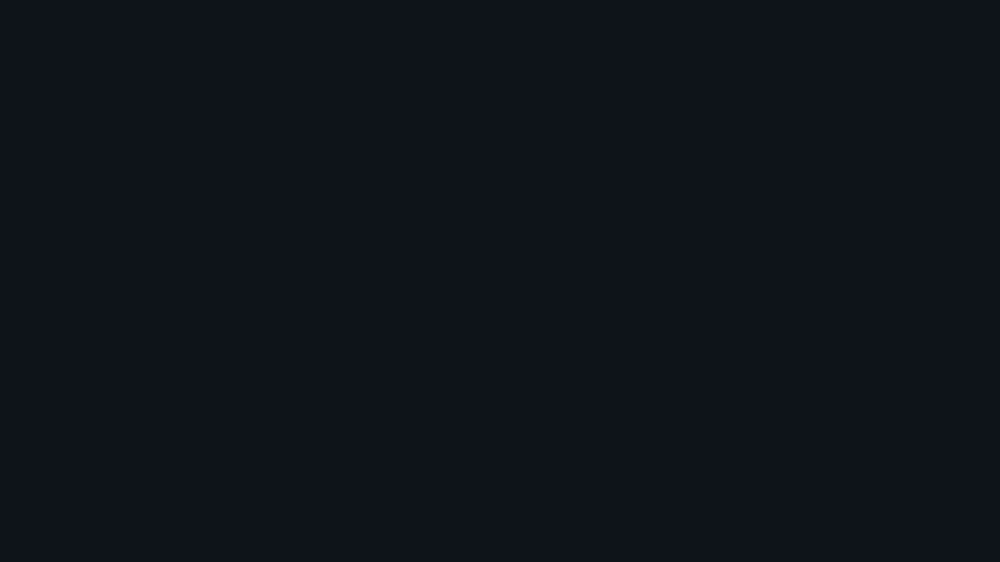
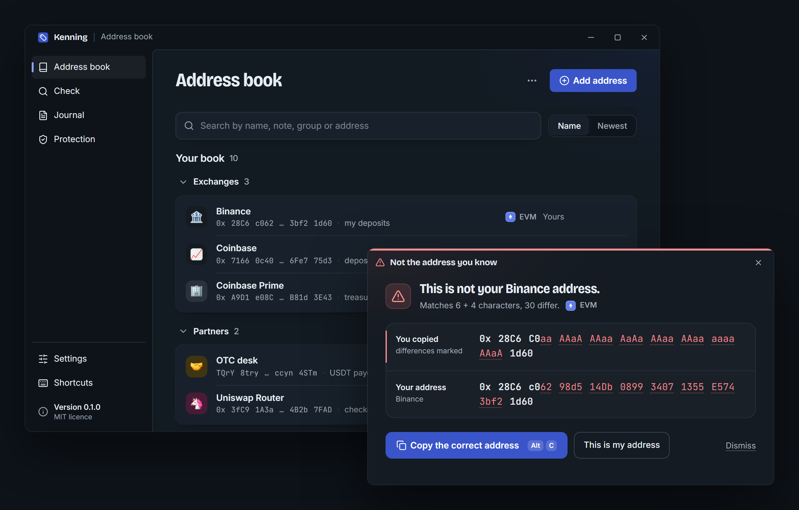

<p align="center">
  <a href="https://github.com/PTK030/kenning"></a>
</p>

<h1 align="center">Kenning</h1>

<p align="center">
  <a href="README.md">English</a> ·
  <a href="README.zh-CN.md">简体中文</a> ·
  <b>日本語</b> ·
  <a href="README.ko.md">한국어</a> ·
  <a href="README.pl.md">Polski</a>
</p>

<p align="center">
  <b>何をコピーしたか、わかる。</b><br>
  Kenning は、コピーした暗号資産アドレスすべてに名前を表示し、知っているアドレスに似ているだけのアドレスをコピーした瞬間に警告します。
</p>

<p align="center">
  <a href="https://getkenning.vercel.app"><b>ウェブサイト</b></a> ·
  <a href="https://github.com/PTK030/kenning/releases"><b>ダウンロード</b></a> ·
  <a href="docs/detection-rules.md"><b>検出ルール</b></a> ·
  <a href="#cli-1"><b>CLI</b></a> ·
  <a href="CHANGELOG.md"><b>変更履歴</b></a> ·
  <a href="CONTRIBUTING.md"><b>コントリビュート</b></a> ·
  <a href="SECURITY.md"><b>セキュリティ</b></a>
</p>

<p align="center">
  <a href="https://github.com/PTK030/kenning/stargazers"></a>
  <a href="CHANGELOG.md"></a>
  <a href="LICENSE"></a>
  <a href="https://www.rust-lang.org"></a>
</p>

<p align="center">
  <a href="https://github.com/PTK030/kenning/releases"></a>
</p>

アドレスポイズニングが成立するのは、多くの人がアドレスの先頭と末尾の数文字しか確認しないからです。攻撃者は、あなたが使っているアドレスと先頭・末尾が同じアドレスを生成し、ごく少額を送金して、あなたが履歴から間違ったほうをコピーするのを待ちます。Kenning は、あなたが使うアドレスをローカルのアドレス帳に保存します。登録済みのアドレスをコピーすると、小さなバッジが名前を表示して消えます。登録済みのアドレスに似ているだけのアドレスをコピーすると、両方を全文で表示し、正しいアドレスを返します。

- **自分で付けた名前：** ウォレット、入金アドレス、マルチシグに一度ラベルを付ければ、コピーするたびにその名前が表示されます。
- **類似アドレスを検出：** 登録済みのアドレスと先頭・末尾が一致するアドレスをコピーすると、違いをすべてマークしたウィンドウが開きます。
- **必要なときに詳細を表示：** どこでもアドレスを選択して `Ctrl+Alt+D` を押すと、名前、履歴、オンチェーンの利用状況が画面中央に表示されます。クリップボードの内容はそのままです。
- **ワンクリックで修正：** 「Copy the correct address」で自分のアドレスをクリップボードに戻し、「This is my address」で新しいアドレスを恒久的に登録します。
- **控えめな設計：** 登録済みのアドレスには数秒間バッジが表示され、オフにできる控えめな通知音が鳴ります。作業中のウィンドウからフォーカスを奪うことはありません。
- **4 つのチェーン：** EIP-55 チェックサム対応の EVM、Solana、Bitcoin（legacy、segwit、taproot）、Tron。
- **出典付きの公開ラベル：** ルーター、ステーブルコイン、取引所は最初から認識され、それぞれにラベルの出典へのリンクが付いています。
- **チーム用アドレス帳とジャーナル：** チームのリポジトリにある読み取り専用のアドレス帳を Kenning に読み込ませ、監査用にすべての確認をローカルに記録できます。
- **ローカルファースト：** アカウント不要、テレメトリなし、サーバーなし。認識エンジンにはネットワーク関連のコードが一切ありません。オンチェーン照会はオプションで、初期設定ではオフです。

<p align="center">
  
</p>

**[類似アドレスの検出方法を読む](docs/detection-rules.md)**：ルールは公開されており、[tests/lookalikes/](tests/lookalikes/) のテストケースも公開しています。

## Kenning を作っている理由

アドレスポイズニングの被害談は、どれも同じ流れでした。ある人が、毎週同じ取引所の入金アドレスに送金しています。ある朝、履歴に金額ゼロの送金が現れます。送信元は `0x28C6` で始まり `1d60` で終わるアドレスで、いつものアドレスとそっくりです。その人は一番新しい行をコピーし、いつもどおり先頭と末尾の文字を確認して、貼り付けます。

この話に不注意な人は一人もいません。ウォレットはアドレスを先頭と末尾だけに省略して表示するので、人はそこを確認するようになります。そして先頭と末尾こそ、攻撃者が GPU を数分回せば作り出せる部分です。研究者の調査では、Ethereum と BSC で 2 年間に 2 億 7,000 万件の攻撃が確認され、少なくとも 8,380 万ドルが失われています（[USENIX Security 2025](https://www.usenix.org/conference/usenixsecurity25/presentation/tsuchiya)）。

人に読んでもらう警告をもう一つ書きたいとは思いませんでした。人にはできない確認を、コンピューターにやってほしかったのです。コピーした瞬間に、実際に使っているアドレスと 1 文字ずつ照合し、それ以外のときは黙っている。それが Kenning です。あなたのマシン上で動き、アカウントは不要で、ルールは公開されているので自分で確認できます。

## 仕組み

| | あなたの操作 | Kenning の動作 |
|---|---|---|
| **1** | ウォレット、エクスプローラー、チャット、スプレッドシートからアドレスをコピーします（Kenning がすべてのコピーを読み取る設定でなければ、`Ctrl+Alt+K` も押します）。 | チェーンごとの形式でアドレスを検証し、あなたのアドレス帳、チームのアドレス帳、公開ラベルから検索します。 |
| **2** | 登録済みのアドレスなら、何もしません。 | 名前入りのバッジを数秒間表示します。フォーカスは奪いません。 |
| **3** | 登録済みのアドレスに似ているだけでも、何もしません。 | 両方のアドレスを全文で表示し、異なる文字をすべてマークしたウィンドウを開きます。ワンクリックで正しいアドレスを戻せます。 |

上記の処理はすべてあなたのマシン上で行われます。[オンチェーン照会](#ネットワーク)をオンにしない限り、どこにも何も送信されません。

## はじめに

### 前提条件

- Windows 10 または 11（macOS と Linux は対応予定）
- [Rust](https://rustup.rs) 1.90 以降
- [Node.js](https://nodejs.org) 20 以降（デスクトップアプリの UI 用）
- WebView2（Windows 11 には標準で搭載）

### デスクトップアプリ（推奨）

```bash
git clone https://github.com/PTK030/kenning
cd kenning/apps/desktop
npm install
npx tauri dev
```

システムトレイにタグのアイコンが表示されます。初回起動時は、6 つの短いステップで設定を案内します。Kenning の通知のしかた、クリップボードを読み取るタイミング（`Ctrl+Alt+K` を押したときだけか、コピーのたびか）、最初のアドレスの登録、いくつかの設定、そして登録済みのアドレスと類似アドレスを使った実際のテストです。

インストーラーをビルドするには：

```bash
npx tauri build
```

これで `target/release/bundle/nsis/Kenning_0.1.0_x64-setup.exe`（ユーザー単位のインストールで、管理者権限は不要）と `target/release/bundle/msi/Kenning_0.1.0_x64_en-US.msi` が生成されます。どちらもまだコード署名されていないため、初回の実行前に Windows SmartScreen の確認が表示されます。インストーラーの画像は `apps/desktop/scripts/make-installer-art.py` で生成しています。インストール済みの環境が更新を受け取れるリリースの公開手順は、[docs/releasing.md](docs/releasing.md) を参照してください。

### CLI

```bash
cargo install --git https://github.com/PTK030/kenning kenning-cli
```

## CLI

バッジとウィンドウが伝える情報は、すべて `ken` コマンドでスクリプトからも得られます。

```bash
# Name an address
ken add 0x28C6c06298d514Db089934071355E5743bf21d60 Binance --note "my deposits"

# Recognise an address (exit code 0 known, 10 new, 20 lookalike)
ken 0x28c6c0aaaaaaaaaaaaaaaaaaaaaaaaaaaaaa1d60

# Every address in a log, a transaction or a chat export
cast logs --from-block latest | ken check -

# Compare two addresses character by character
ken diff 0x28C6c06298d514Db089934071355E5743bf21d60 0x28c6c0aaaaaaaaaaaaaaaaaaaaaaaaaaaaaa1d60

# Import a Safe{Wallet} address book export, or Kenning's own CSV
ken import safe-address-book.csv --owner team

# What was checked, when, by whom
ken log

# Ask the chain too (sends only the address)
ken --online 0x68b3465833fb72A70ecDF485E0e4C7bD8665Fc45
```

類似アドレスは、ターミナルでは次のように表示されます。

```text
$ ken 0x28C6C0aaAAaAAAaaAaAaAAaaAAaaaaaaAAaA1d60
! This is not your Binance address.  lookalike
  Matches 6 + 4 characters, 30 differ.

  copied  0x 28C6 C0aa AAaA AAaa AaAa AAaa AAaa aaaa AAaA 1d60
  yours   0x 28C6 c062 98d5 14Db 0899 3407 1355 E574 3bf2 1d60  Binance

  The address you know is the second line: 0x28C6c06298d514Db089934071355E5743bf21d60
```

すべてのコマンドが `--json` に対応しています。`ken serve --stdio` はほかのプログラムと JSON-RPC で通信し、`ken paths` は Kenning のファイルの保存場所を表示します。

## ネットワーク

オンチェーン照会は、自分でオンにするまで無効です（トレイメニューまたは Settings から、あるいはコマンドごとに `--online` を指定）。オンにすると、Kenning は表示中のアドレスだけを、チェーンごとに 1 つの公開プロバイダーへ送信します。それ以外は何も送りません。

| チェーン | ホスト |
|---|---|
| EVM（Ethereum メインネット） | `eth.blockscout.com` |
| Solana | `api.mainnet-beta.solana.com`、または独自の RPC |
| Bitcoin | `mempool.space` |
| Tron | `api.trongrid.io` |

表示されるのは、そのアドレスが使われたことがあるか、トランザクション数、検証済みのコントラクトかどうかです。一度も使われていない類似アドレスは、強い危険信号です。応答は 1 時間キャッシュされます。照会処理は `crates/kenning-net` にあり、`crates/kenning-core` にはネットワークコードを含めません。これは `cargo deny` で強制しています。

更新チェック（起動時と 12 時間ごと、接続先は github.com のみ）は、セットアップ時に有効にするか選べます。Settings でオフにすることもできます。

## ファイル

すべて `~/.kenning`（または `KENNING_HOME`）に保存されます。

| ファイル | 内容 |
|---|---|
| `book.toml` | アドレス帳です。プレーンな TOML なので、編集やコミットも安全です。 |
| `config.toml` | 設定です。共有するチーム用アドレス帳の指定も含みます（例：`books = ["~/repo/ops/kenning.toml"]`）。 |
| `history.json` | コピーしたアドレスと、その回数と日時。記録するのは検証済みのアドレスだけで、クリップボードのほかのテキストは記録しません。オフにできます。 |
| `journal.jsonl` | 検証ジャーナルです。 |
| `net-cache.json` | オンチェーン照会の応答。ネットワークがオンのときのみ作成されます。 |

## ロードマップ

| 完了 | 進行中 | 次の予定 |
|---|---|---|
| EVM、Solana、Bitcoin、Tron（チェックサム対応） | 初回リリース（GitHub でインストーラーを配布） | Linux と macOS |
| 公開ルールと 17 件のテストケースによる類似アドレス検出 | | 署名済みインストーラー |
| バッジ、類似アドレスのウィンドウ、詳細ウィンドウ | | オープンソースのウォレットに組み込めるライブラリとしてのエンジン |
| JSON 出力と JSON-RPC に対応したコマンドライン | | バージョン管理された仕様としての検出ルール |
| チーム用アドレス帳、ローカルのジャーナル、Safe{Wallet} からのインポート | | |
| オンチェーン照会（初期設定ではオフ） | | |

各バージョンの変更点は[変更履歴](CHANGELOG.md)にあります。

## 開発

```bash
npm install          # at the root: the git hooks
npm run dev          # the desktop app, reloading as you edit
npm run check        # what CI runs: clippy, tests, builds, contrast
npm run deny         # the licence check, and no network code in kenning-core
```

```
crates/kenning-core     recognition, lookalikes, book, history, journal (no network code)
crates/kenning-net      optional on-chain lookups
crates/kenning-cli      the `ken` binary
crates/kenning-labels   built-in public labels, each with a source
apps/desktop            tray app: Tauri 2, TypeScript, no UI framework
tests/lookalikes        public test corpus for the detection rules
```

検出ルールを変更するときは、[docs/detection-rules.md](docs/detection-rules.md) の更新と、[tests/lookalikes/](tests/lookalikes/) への新しいケースの追加をあわせて行ってください。デスクトップのシェルを選んだ経緯と計測結果は [docs/desktop-gate.md](docs/desktop-gate.md) にあります。[docs/development.md](docs/development.md) では、ディレクトリ構成、開発用のデータディレクトリ、つまずきやすい点を説明しています。

## コントリビュート

Issue とプルリクエストを歓迎します。小さな修正を超える変更は、作業に時間をかける前に方針を合意できるよう、先に Issue を作成してください。[CONTRIBUTING.md](CONTRIBUTING.md) には、セットアップ方法、プルリクエスト前に実行するチェック、コミットの形式、そして Kenning の信頼性を保つためのルールが書かれています。

- `kenning-core` はネットワークに一切接続しません。
- クリップボードから読み取ったものは、有効なアドレス以外は保存しません。
- 警告が勝手に操作を実行することはなく、誤って押されたキーを同意とみなすこともありません。

参加者全員に[行動規範](CODE_OF_CONDUCT.md)の遵守をお願いしています。

## セキュリティ

Kenning はあなたと送金の間に立つツールなので、欠陥があれば誰かが資金を失うおそれがあります。脆弱性を見つけたら、公開の Issue は作成せず、[Report a vulnerability](https://github.com/PTK030/kenning/security/advisories/new) から報告してください。検出をすり抜けた類似アドレスも対象です。対象範囲と、Kenning を安全にするための設計については [SECURITY.md](SECURITY.md) にまとめています。

## Kenning を支援する

Kenning は無料のオープンソースで、一人で開発しています。特に助かるのは次のことです。

- **リポジトリにスターを付ける。** 間違ったアドレスを貼り付けてしまう前に、より多くの人が Kenning を見つけられるようになります。
- **[Kenning が見逃した類似アドレスを報告する](https://github.com/PTK030/kenning/security/advisories/new)**（非公開で）。修正され、[tests/lookalikes/](tests/lookalikes/) のテストケースになります。
- **履歴からコピーしたアドレスに送金しているチームの担当者に、Kenning を紹介する。**

## ライセンス

[MIT](LICENSE)

アドレス帳の絵文字アートワークは Google の [Noto Emoji](https://github.com/googlefonts/noto-emoji) 3D セットで、独自のライセンスで提供されています。詳しくは [apps/desktop/ui/src/assets/emoji/](apps/desktop/ui/src/assets/emoji/) を参照してください。
