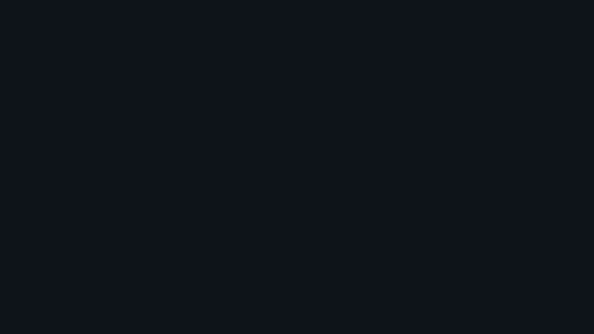
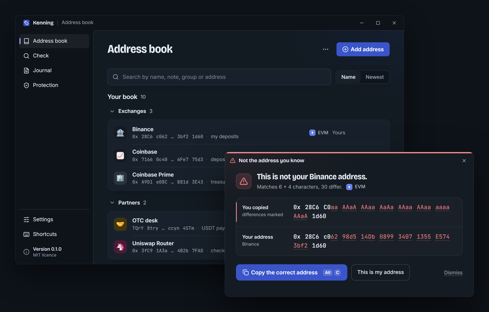

<p align="center">
  <a href="https://github.com/PTK030/kenning"></a>
</p>

<h1 align="center">Kenning</h1>

<p align="center">
  <a href="README.md">English</a> ·
  <a href="README.zh-CN.md">简体中文</a> ·
  <a href="README.ja.md">日本語</a> ·
  <b>한국어</b> ·
  <a href="README.pl.md">Polski</a>
</p>

<p align="center">
  <b>무엇을 복사했는지 확인하세요.</b><br>
  Kenning은 복사하는 모든 암호화폐 주소에 이름을 붙여 보여 주고, 아는 주소와 겉모습만 닮은 주소를 복사하는 순간 경고합니다.
</p>

<p align="center">
  <a href="https://getkenning.vercel.app"><b>웹사이트</b></a> ·
  <a href="https://github.com/PTK030/kenning/releases"><b>다운로드</b></a> ·
  <a href="docs/detection-rules.md"><b>탐지 규칙</b></a> ·
  <a href="#cli-1"><b>CLI</b></a> ·
  <a href="CHANGELOG.md"><b>변경 내역</b></a> ·
  <a href="CONTRIBUTING.md"><b>기여하기</b></a> ·
  <a href="SECURITY.md"><b>보안</b></a>
</p>

<p align="center">
  <a href="https://github.com/PTK030/kenning/stargazers"></a>
  <a href="CHANGELOG.md"></a>
  <a href="LICENSE"></a>
  <a href="https://www.rust-lang.org"></a>
</p>

<p align="center">
  <a href="https://github.com/PTK030/kenning/releases"></a>
</p>

주소 포이즈닝(address poisoning)이 통하는 이유는 사람들이 주소의 앞뒤 몇 글자만 확인하기 때문입니다. 공격자는 여러분이 쓰는 주소와 앞뒤가 같은 주소를 만들어 아주 적은 금액을 보낸 뒤, 여러분이 거래 내역에서 잘못된 주소를 복사하기를 기다립니다. Kenning은 여러분이 사용하는 주소를 로컬 주소록에 보관합니다. 이미 아는 주소를 복사하면 작은 배지가 이름을 확인해 주고 사라집니다. 아는 주소와 닮기만 한 주소를 복사하면 두 주소를 모두 전체로 보여 주고 올바른 주소를 돌려줍니다.

- **내가 정한 이름:** 지갑, 입금 주소, 멀티시그에 한 번만 라벨을 붙이면 복사할 때마다 이름이 보입니다.
- **닮은 주소 탐지:** 복사한 주소가 아는 주소와 앞뒤가 같으면 모든 차이를 표시한 창이 열립니다.
- **필요할 때 상세 정보:** 어디서든 주소를 선택하고 `Ctrl+Alt+D`를 누르면 화면 가운데에 이름, 기록, 온체인 활동이 표시됩니다. 클립보드는 그대로 유지됩니다.
- **클릭 한 번으로 해결:** "Copy the correct address"를 누르면 내 주소가 클립보드에 다시 들어가고, "This is my address"를 누르면 새 주소를 계속 기억합니다.
- **조용한 설계:** 아는 주소에는 몇 초 동안 배지가 뜨고, 끌 수 있는 부드러운 알림음이 납니다. 하던 작업에서 포커스를 빼앗지 않습니다.
- **네 가지 체인:** EIP-55 체크섬을 지원하는 EVM, Solana, Bitcoin(legacy, segwit, taproot), Tron.
- **출처가 있는 공개 라벨:** 라우터, 스테이블코인, 거래소를 기본으로 인식하며, 라벨마다 출처 링크가 붙어 있습니다.
- **팀 주소록과 저널:** 팀 저장소에 있는 읽기 전용 주소록을 Kenning에 연결하고, 감사용으로 모든 확인 기록을 로컬에 남길 수 있습니다.
- **로컬 우선:** 계정도, 텔레메트리도, 서버도 없습니다. 인식 엔진에는 네트워크 코드가 전혀 없으며, 온체인 조회는 선택 사항이고 기본적으로 꺼져 있습니다.

<p align="center">
  
</p>

**[닮은 주소를 탐지하는 방법 읽어 보기](docs/detection-rules.md)**: 규칙은 공개되어 있으며, [tests/lookalikes/](tests/lookalikes/)의 테스트 케이스도 마찬가지입니다.

## Kenning을 만드는 이유

제가 읽은 주소 포이즈닝 사례는 모두 같은 식으로 흘러갔습니다. 누군가 매주 같은 거래소 입금 주소로 송금합니다. 어느 날 아침, 거래 내역에 금액이 0인 전송이 하나 나타납니다. 보낸 주소는 그 사람의 주소처럼 `0x28C6`으로 시작하고 `1d60`으로 끝납니다. 그는 가장 최근 행을 복사하고, 늘 하던 대로 앞뒤 글자를 확인한 뒤 붙여넣습니다.

이 이야기에서 부주의한 사람은 없습니다. 지갑은 주소를 앞뒤만 남기고 줄여 보여 주기 때문에, 사람들은 그 부분을 확인하는 데 익숙해집니다. 그런데 그 앞뒤야말로 공격자가 그래픽 카드로 몇 분이면 만들어 낼 수 있는 부분입니다. 연구자들은 2년 동안 Ethereum과 BSC에서 2억 7천만 건의 시도와 최소 8,380만 달러의 피해를 집계했습니다([USENIX Security 2025](https://www.usenix.org/conference/usenixsecurity25/presentation/tsuchiya)).

사람들이 읽어야 할 경고문을 하나 더 쓰고 싶지는 않았습니다. 사람이 할 수 없는 확인 하나를 컴퓨터가 대신 하기를 원했습니다. 복사하는 순간 모든 글자를 실제로 쓰는 주소와 비교하고, 나머지 시간에는 조용히 있는 것입니다. 그것이 Kenning입니다. 여러분의 컴퓨터에서 실행되고, 계정이 필요 없으며, 규칙이 공개되어 있어 직접 확인할 수 있습니다.

## 작동 방식

| | 사용자가 하는 일 | Kenning이 하는 일 |
|---|---|---|
| **1** | 지갑, 블록 익스플로러, 채팅, 스프레드시트에서 주소를 복사합니다(Kenning이 모든 복사를 읽도록 설정하지 않았다면 `Ctrl+Alt+K`도 누릅니다). | 해당 체인 기준으로 주소를 검증하고, 내 주소록, 팀 주소록, 공개 라벨에서 찾습니다. |
| **2** | 아는 주소라면 아무것도 하지 않습니다. | 포커스를 빼앗지 않고 몇 초 동안 이름이 적힌 배지를 보여 줍니다. |
| **3** | 아는 주소와 닮기만 한 주소여도 아무것도 하지 않습니다. | 두 주소를 전체로 보여 주고 서로 다른 글자를 모두 표시한 창을 엽니다. 클릭 한 번으로 올바른 주소를 되돌려 놓습니다. |

위의 모든 과정은 여러분의 컴퓨터에서 일어납니다. [온체인 조회](#네트워크)를 켜지 않는 한 어디로도 아무것도 전송되지 않습니다.

## 시작하기

### 사전 요구 사항

- Windows 10 또는 11 (macOS와 Linux는 지원 예정)
- [Rust](https://rustup.rs) 1.90 이상
- [Node.js](https://nodejs.org) 20 이상 (데스크톱 앱 인터페이스용)
- WebView2 (Windows 11에 기본 포함)

### 데스크톱 앱 (권장)

```bash
git clone https://github.com/PTK030/kenning
cd kenning/apps/desktop
npm install
npx tauri dev
```

시스템 트레이에 태그 아이콘이 나타납니다. 처음 실행하면 짧은 여섯 단계를 안내합니다. Kenning이 알려 주는 방식, 클립보드를 읽는 시점(`Ctrl+Alt+K`를 누를 때만 또는 복사할 때마다), 첫 주소 등록, 몇 가지 설정, 그리고 아는 주소와 닮은 주소로 해 보는 실제 테스트입니다.

설치 파일을 빌드하려면:

```bash
npx tauri build
```

이 명령은 `target/release/bundle/nsis/Kenning_0.1.0_x64-setup.exe`(사용자별 설치, 관리자 권한 불필요)와 `target/release/bundle/msi/Kenning_0.1.0_x64_en-US.msi`를 만듭니다. 둘 다 아직 코드 서명이 되어 있지 않아, 실행 전에 Windows SmartScreen이 한 번 확인을 요청합니다. 설치 프로그램 이미지는 `apps/desktop/scripts/make-installer-art.py`로 만듭니다. 설치된 앱이 업데이트를 받을 수 있도록 릴리스를 게시하는 방법은 [docs/releasing.md](docs/releasing.md)를 참고하세요.

### CLI

```bash
cargo install --git https://github.com/PTK030/kenning kenning-cli
```

## CLI

배지와 창이 사용자에게 알려 주는 모든 내용을 `ken` 명령은 스크립트에 알려 줍니다.

```bash
# Name an address
ken add 0x28C6c06298d514Db089934071355E5743bf21d60 Binance --note "my deposits"

# Recognise an address (exit code 0 known, 10 new, 20 lookalike)
ken 0x28c6c0aaaaaaaaaaaaaaaaaaaaaaaaaaaaaa1d60

# Every address in a log, a transaction or a chat export
cast logs --from-block latest | ken check -

# Compare two addresses character by character
ken diff 0x28C6c06298d514Db089934071355E5743bf21d60 0x28c6c0aaaaaaaaaaaaaaaaaaaaaaaaaaaaaa1d60

# Import a Safe{Wallet} address book export, or Kenning's own CSV
ken import safe-address-book.csv --owner team

# What was checked, when, by whom
ken log

# Ask the chain too (sends only the address)
ken --online 0x68b3465833fb72A70ecDF485E0e4C7bD8665Fc45
```

터미널에서 닮은 주소는 이렇게 보입니다.

```text
$ ken 0x28C6C0aaAAaAAAaaAaAaAAaaAAaaaaaaAAaA1d60
! This is not your Binance address.  lookalike
  Matches 6 + 4 characters, 30 differ.

  copied  0x 28C6 C0aa AAaA AAaa AaAa AAaa AAaa aaaa AAaA 1d60
  yours   0x 28C6 c062 98d5 14Db 0899 3407 1355 E574 3bf2 1d60  Binance

  The address you know is the second line: 0x28C6c06298d514Db089934071355E5743bf21d60
```

모든 명령은 `--json`을 지원합니다. `ken serve --stdio`는 다른 프로그램과 JSON-RPC로 통신하고, `ken paths`는 Kenning이 파일을 보관하는 위치를 보여 줍니다.

## 네트워크

온체인 조회는 직접 켜기 전까지 꺼져 있습니다(트레이 메뉴나 Settings에서 켜거나, 명령마다 `--online` 사용). 켜면 Kenning은 화면에 표시 중인 주소만 체인마다 하나의 공개 제공자에게 보냅니다. 그 밖에는 아무것도 보내지 않습니다.

| 체인 | 호스트 |
|---|---|
| EVM (Ethereum mainnet) | `eth.blockscout.com` |
| Solana | `api.mainnet-beta.solana.com` 또는 직접 지정한 RPC |
| Bitcoin | `mempool.space` |
| Tron | `api.trongrid.io` |

주소가 사용된 적이 있는지, 거래 횟수, 검증된 컨트랙트인지를 보여 줍니다. 한 번도 사용되지 않은 닮은 주소는 강력한 위험 신호입니다. 응답은 1시간 동안 캐시됩니다. 조회 기능은 `crates/kenning-net`에 있고, `crates/kenning-core`에는 네트워크 코드가 들어가지 않습니다. 이 규칙은 `cargo deny`로 강제합니다.

업데이트 확인(시작할 때와 12시간마다, github.com에만 접속)은 초기 설정 중에 선택할 수 있고 Settings에서 끌 수 있습니다.

## 파일

모든 파일은 `~/.kenning`(또는 `KENNING_HOME`)에 저장됩니다.

| 파일 | 내용 |
|---|---|
| `book.toml` | 주소록. 일반 TOML 파일이라 직접 편집하고 커밋해도 됩니다. |
| `config.toml` | 설정. 공유 팀 주소록도 여기서 지정합니다: `books = ["~/repo/ops/kenning.toml"]`. |
| `history.json` | 복사한 주소와 복사 횟수, 시각. 검증된 주소만 저장하며 클립보드의 다른 텍스트는 저장하지 않습니다. 끌 수 있습니다. |
| `journal.jsonl` | 검증 저널. |
| `net-cache.json` | 온체인 응답. 네트워크를 켠 경우에만 생깁니다. |

## 로드맵

| 완료 | 진행 중 | 다음 |
|---|---|---|
| 체크섬을 포함한 EVM, Solana, Bitcoin, Tron 지원 | GitHub 설치 파일을 포함한 첫 릴리스 | Linux와 macOS |
| 공개 규칙과 17개 테스트 케이스를 갖춘 닮은 주소 탐지 | | 서명된 설치 파일 |
| 배지, 닮은 주소 창, 상세 정보 창 | | 오픈 소스 지갑에 내장할 수 있는 라이브러리 형태의 엔진 |
| JSON 출력과 JSON-RPC를 지원하는 명령줄 도구 | | 버전 관리되는 명세로서의 탐지 규칙 |
| 팀 주소록, 로컬 저널, Safe{Wallet} 가져오기 | | |
| 온체인 조회(기본값 꺼짐) | | |

버전별 변경 사항은 [변경 내역](CHANGELOG.md)에서 볼 수 있습니다.

## 개발

```bash
npm install          # at the root: the git hooks
npm run dev          # the desktop app, reloading as you edit
npm run check        # what CI runs: clippy, tests, builds, contrast
npm run deny         # the licence check, and no network code in kenning-core
```

```
crates/kenning-core     recognition, lookalikes, book, history, journal (no network code)
crates/kenning-net      optional on-chain lookups
crates/kenning-cli      the `ken` binary
crates/kenning-labels   built-in public labels, each with a source
apps/desktop            tray app: Tauri 2, TypeScript, no UI framework
tests/lookalikes        public test corpus for the detection rules
```

탐지 규칙을 바꿀 때는 [docs/detection-rules.md](docs/detection-rules.md)와 [tests/lookalikes/](tests/lookalikes/)의 새 케이스도 함께 수정합니다. 데스크톱 셸을 결정한 과정과 측정 결과는 [docs/desktop-gate.md](docs/desktop-gate.md)에 있습니다. [docs/development.md](docs/development.md)는 프로젝트 구조, 개발용 데이터 디렉터리, 주의할 점을 다룹니다.

## 기여하기

이슈와 풀 리퀘스트를 환영합니다. 작은 수정보다 큰 작업이라면 시간을 들이기 전에 먼저 이슈를 열어 접근 방식을 합의해 주세요. [CONTRIBUTING.md](CONTRIBUTING.md)에는 개발 환경 설정, 풀 리퀘스트 전에 실행할 검사, 커밋 형식, 그리고 Kenning을 믿을 수 있게 지키는 규칙이 정리되어 있습니다.

- `kenning-core`는 절대 네트워크와 통신하지 않습니다.
- 클립보드에서 읽은 내용은 유효한 주소를 제외하고 아무것도 저장하지 않습니다.
- 경고는 절대 스스로 동작하지 않으며, 실수로 누른 키를 동의로 받아들이지 않습니다.

참여하는 모든 분은 [행동 강령](CODE_OF_CONDUCT.md)을 따라야 합니다.

## 보안

Kenning은 사용자와 송금 사이에 서 있는 도구이므로, 결함 하나가 누군가의 자금 손실로 이어질 수 있습니다. 취약점은 공개 이슈로 올리지 말고 [Report a vulnerability](https://github.com/PTK030/kenning/security/advisories/new)로 신고해 주세요. 탐지를 빠져나간 닮은 주소도 취약점에 해당합니다. [SECURITY.md](SECURITY.md)에는 신고 대상 범위와 Kenning이 안전하도록 설계된 방식이 정리되어 있습니다.

## Kenning 응원하기

Kenning은 무료 오픈 소스이며 한 사람이 만들고 있습니다. 가장 도움이 되는 일은 다음과 같습니다.

- **저장소에 스타를 눌러 주세요.** 더 많은 사람이 잘못된 주소를 붙여넣기 전에 Kenning을 발견할 수 있습니다.
- **[Kenning이 놓친 닮은 주소를 신고해 주세요](https://github.com/PTK030/kenning/security/advisories/new).** 비공개로 신고해 주시면 수정한 뒤 [tests/lookalikes/](tests/lookalikes/)의 케이스로 추가합니다.
- **거래 내역에서 복사한 주소로 송금하는 팀원에게 Kenning을 소개해 주세요.**

## 라이선스

[MIT](LICENSE)

주소록의 이모지 아트워크는 Google의 [Noto Emoji](https://github.com/googlefonts/noto-emoji) 3D 세트이며 별도 라이선스를 따릅니다. [apps/desktop/ui/src/assets/emoji/](apps/desktop/ui/src/assets/emoji/)를 참고하세요.
