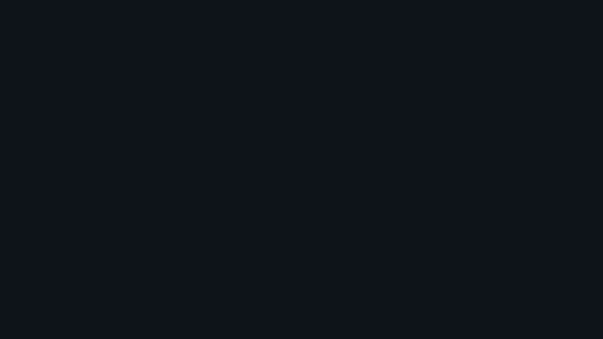
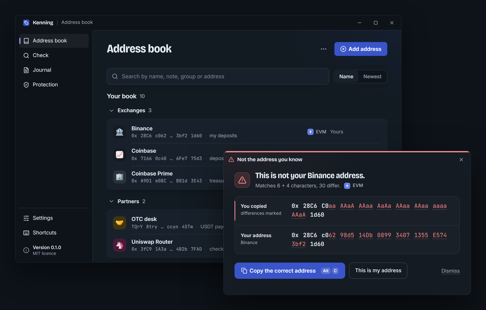

<p align="center">
  <a href="https://github.com/PTK030/kenning"></a>
</p>

<h1 align="center">Kenning</h1>

<p align="center">
  <b>English</b> ·
  <a href="README.zh-CN.md">简体中文</a> ·
  <a href="README.ja.md">日本語</a> ·
  <a href="README.ko.md">한국어</a> ·
  <a href="README.pl.md">Polski</a>
</p>

<p align="center">
  <b>Know what you copied.</b><br>
  Kenning names every crypto address you copy and warns you the moment one only looks like an address you know.
</p>

<p align="center">
  <a href="https://github.com/PTK030/kenning/releases"><b>Download</b></a> ·
  <a href="docs/detection-rules.md"><b>Detection rules</b></a> ·
  <a href="#cli-1"><b>CLI</b></a> ·
  <a href="CHANGELOG.md"><b>Changelog</b></a> ·
  <a href="CONTRIBUTING.md"><b>Contributing</b></a> ·
  <a href="SECURITY.md"><b>Security</b></a>
</p>

<p align="center">
  <a href="https://github.com/PTK030/kenning/stargazers"></a>
  <a href="CHANGELOG.md"></a>
  <a href="LICENSE"></a>
  <a href="https://www.rust-lang.org"></a>
</p>

<p align="center">
  <a href="https://github.com/PTK030/kenning/releases"></a>
</p>

Address poisoning works because people check the first and last few characters of an address. Someone generates an address with the same start and end as one you use, sends you a tiny transfer, and waits for you to copy the wrong one from your history. Kenning keeps a local book of the addresses you use. When you copy an address it already knows, a small badge confirms the name and disappears. When you copy one that only resembles an address you know, it shows both in full and gives you the correct one back.

- **Your names:** label wallets, deposit addresses and multisigs once, and see the name every time you copy them.
- **Lookalikes caught:** a copied address that shares its start and end with a known one opens a window with every difference marked.
- **Details on demand:** select an address anywhere and press `Ctrl+Alt+D` to see its name, history and on-chain activity in the middle of the screen. Your clipboard is left as it was.
- **One click to fix:** "Copy the correct address" puts yours back on the clipboard; "This is my address" remembers a new one for good.
- **Quiet by design:** known addresses get a badge for a few seconds, with a soft sound you can turn off. Nothing takes focus from what you are doing.
- **Four chains:** EVM with EIP-55 checksums, Solana, Bitcoin (legacy, segwit, taproot) and Tron.
- **Public labels with sources:** routers, stablecoins and exchanges are recognised out of the box, each with a link to where the label came from.
- **Team books and a journal:** point Kenning at a read-only book in your team's repo, and keep a local record of every check for audits.
- **Local-first:** no account, no telemetry, no servers. The recognition engine has no network code at all; on-chain lookups are optional and off by default.

<p align="center">
  
</p>

**[Read how lookalikes are detected](docs/detection-rules.md)**: the rules are public, and so are the test cases in [tests/lookalikes/](tests/lookalikes/).

## Why I'm building Kenning

Every address-poisoning story I read went the same way. Someone pays the same exchange deposit address every week. One morning a zero-value transfer shows up in their history, from an address that starts with `0x28C6` and ends with `1d60`, just like theirs. They copy the newest row, check the first and last characters as always, and paste.

Nobody in that story is careless. Wallets shorten addresses to their start and end, so that is what people learn to check. And the start and end are exactly what an attacker can produce with a few minutes on a graphics card. Researchers counted 270 million attempts on Ethereum and BSC in two years, and at least $83.8M lost ([USENIX Security 2025](https://www.usenix.org/conference/usenixsecurity25/presentation/tsuchiya)).

I didn't want to write another warning for people to read. I wanted the computer to do the one check people can't: compare every character against the addresses you actually use, at the moment you copy, and stay quiet the rest of the time. That's Kenning. It runs on your machine, needs no account, and its rules are public so you can check them yourself.

## How it works

| | You do | Kenning does |
|---|---|---|
| **1** | Copy an address from a wallet, an explorer, a chat or a spreadsheet (and press `Ctrl+Alt+K`, unless Kenning reads every copy). | Validates it for its chain and looks it up in your book, your team's books and the public labels. |
| **2** | Nothing, if it is one you know. | Shows a badge with its name for a few seconds, without taking focus. |
| **3** | Nothing, if it only looks like one you know. | Opens a window with both addresses in full and every differing character marked. One click puts the correct address back. |

Everything above happens on your machine. Nothing is sent anywhere unless you turn on [on-chain lookups](#network).

### Clipboard guard

Poisoning gets you to copy the wrong address. A clipper gets the wrong one pasted without you copying it: malware such as Laplas or MassJacker waits in the background and, the moment you copy an address, writes its own over it, often one that shares your first and last characters.

With the guard on, Kenning watches every clipboard change. A copy that is replaced by another address of the same chain within moments is a swap when no key or click came in between, when it was written by a program other than the one in front, or when the new address looks like yours. Kenning then tells you not to paste, names the program that wrote it, and puts your address back with one click. It also warns when a recovery phrase or a private key is left on the clipboard.

**Protection › Run the test** shows whether anything on your computer swaps addresses right now: Kenning copies a well-known public address of each chain and watches whether something writes over it.

The guard reads every copy, so it is off until you turn it on (the onboarding offers it with "Every time I copy"). Nothing it sees is written to disk. It is not an antivirus: it tells you that something swaps addresses and what it is, and removing it is up to you.

## Getting Started

### Prerequisites

- Windows 10 or 11 (macOS and Linux are planned)
- [Rust](https://rustup.rs) 1.90 or newer
- [Node.js](https://nodejs.org) 20 or newer, for the desktop app's interface
- WebView2, which ships with Windows 11

### Desktop app (recommended)

```bash
git clone https://github.com/PTK030/kenning
cd kenning/apps/desktop
npm install
npx tauri dev
```

The tag icon appears in the system tray. The first launch walks you through six short steps: how Kenning speaks, when it reads the clipboard (only on `Ctrl+Alt+K`, or on every copy), your first addresses, a few preferences, and a live test with a known address and a lookalike.

To build the installers:

```bash
npx tauri build
```

This produces `target/release/bundle/nsis/Kenning_0.1.0_x64-setup.exe` (per-user, no admin rights needed) and `target/release/bundle/msi/Kenning_0.1.0_x64_en-US.msi`. Neither is code-signed yet, so Windows SmartScreen asks once before running them. Installer artwork comes from `apps/desktop/scripts/make-installer-art.py`. Publishing a release that installed copies can update to: [docs/releasing.md](docs/releasing.md).

### CLI

```bash
cargo install --git https://github.com/PTK030/kenning kenning-cli
```

## CLI

Everything the badge and the window tell you, the `ken` command tells your scripts.

```bash
# Name an address
ken add 0x28C6c06298d514Db089934071355E5743bf21d60 Binance --note "my deposits"

# Recognise an address (exit code 0 known, 10 new, 20 lookalike)
ken 0x28c6c0aaaaaaaaaaaaaaaaaaaaaaaaaaaaaa1d60

# Every address in a log, a transaction or a chat export
cast logs --from-block latest | ken check -

# Compare two addresses character by character
ken diff 0x28C6c06298d514Db089934071355E5743bf21d60 0x28c6c0aaaaaaaaaaaaaaaaaaaaaaaaaaaaaa1d60

# Import a Safe{Wallet} address book export, or Kenning's own CSV
ken import safe-address-book.csv --owner team

# What was checked, when, by whom
ken log

# Ask the chain too (sends only the address)
ken --online 0x68b3465833fb72A70ecDF485E0e4C7bD8665Fc45
```

What a lookalike looks like in the terminal:

```text
$ ken 0x28C6C0aaAAaAAAaaAaAaAAaaAAaaaaaaAAaA1d60
! This is not your Binance address.  lookalike
  Matches 6 + 4 characters, 30 differ.

  copied  0x 28C6 C0aa AAaA AAaa AaAa AAaa AAaa aaaa AAaA 1d60
  yours   0x 28C6 c062 98d5 14Db 0899 3407 1355 E574 3bf2 1d60  Binance

  The address you know is the second line: 0x28C6c06298d514Db089934071355E5743bf21d60
```

Every command takes `--json`. `ken serve --stdio` speaks JSON-RPC for other programs, and `ken paths` shows where Kenning keeps its files.

## Network

On-chain lookups are off until you turn them on (tray menu or Settings, or `--online` per command). When on, Kenning sends the address it is showing, and nothing else, to one public provider per chain:

| Chain | Host |
|---|---|
| EVM (Ethereum mainnet) | `eth.blockscout.com` |
| Solana | `api.mainnet-beta.solana.com`, or your own RPC |
| Bitcoin | `mempool.space` |
| Tron | `api.trongrid.io` |

It shows whether an address has ever been used, its transaction count, and whether it is a verified contract. A lookalike that was never used is a strong sign. Answers are cached for an hour. The lookups live in `crates/kenning-net`; `crates/kenning-core` stays free of network code, and `cargo deny` enforces it.

Update checks (at start and every 12 hours, to github.com only) are offered during setup and can be turned off in Settings.

## Files

Everything lives in `~/.kenning` (or `KENNING_HOME`):

| File | Contents |
|---|---|
| `book.toml` | Your address book. Plain TOML, safe to edit and commit. |
| `config.toml` | Settings, including shared team books: `books = ["~/repo/ops/kenning.toml"]`. |
| `history.json` | Addresses you copied, how often and when. Validated addresses only, never other clipboard text. Can be turned off. |
| `journal.jsonl` | The verification journal. |
| `net-cache.json` | On-chain answers, only if the network is on. |

## Roadmap

| Done | Now | Next |
|---|---|---|
| EVM, Solana, Bitcoin and Tron, with checksums | First release, with installers on GitHub | Linux and macOS |
| Lookalike detection with public rules and 17 test cases | | Signed installers |
| Badge, lookalike window and details window | | The engine as a library that open-source wallets can embed |
| Clipboard guard against clipper malware, with a clipboard test | | |
| Command line with JSON output and JSON-RPC | | Detection rules as a versioned specification |
| Team books, a local journal, Safe{Wallet} import | | |
| On-chain lookups, off by default | | |

What changed in each version is in the [changelog](CHANGELOG.md).

## Development

```bash
npm install          # at the root: the git hooks
npm run dev          # the desktop app, reloading as you edit
npm run check        # what CI runs: clippy, tests, builds, contrast
npm run deny         # the licence check, and no network code in kenning-core
```

```
crates/kenning-core     recognition, lookalikes, book, history, journal (no network code)
crates/kenning-net      optional on-chain lookups
crates/kenning-cli      the `ken` binary
crates/kenning-labels   built-in public labels, each with a source
apps/desktop            tray app: Tauri 2, TypeScript, no UI framework
tests/lookalikes        public test corpus for the detection rules
```

Changes to the detection rules go together with [docs/detection-rules.md](docs/detection-rules.md) and new cases in [tests/lookalikes/](tests/lookalikes/). The desktop shell decision and its measurements are in [docs/desktop-gate.md](docs/desktop-gate.md). [docs/development.md](docs/development.md) covers the layout, the development data directory and the pitfalls.

## Contributing

Issues and pull requests are welcome. For anything bigger than a small fix, open an issue first, so the approach is agreed before you spend time on it. [CONTRIBUTING.md](CONTRIBUTING.md) has the setup, the checks to run before a pull request, the commit format, and the rules that keep Kenning trustworthy:

- `kenning-core` never talks to the network.
- Nothing read from the clipboard is stored, except valid addresses.
- A warning never acts on its own and never takes a stray key as consent.

Everyone taking part is expected to follow the [Code of Conduct](CODE_OF_CONDUCT.md).

## Security

Kenning stands between you and a payment, so a flaw in it can cost someone their funds. Please don't open a public issue for one: use [Report a vulnerability](https://github.com/PTK030/kenning/security/advisories/new) instead. A lookalike that gets through counts. [SECURITY.md](SECURITY.md) lists what is in scope and how Kenning is built to be safe.

## Support Kenning

Kenning is free, open source and built by one person. The most useful things you can do:

- **Star the repo** so more people find it before they paste the wrong address.
- **[Report a lookalike Kenning missed](https://github.com/PTK030/kenning/security/advisories/new)**, privately, so it can be fixed and become a case in [tests/lookalikes/](tests/lookalikes/).
- **Show it to whoever on your team pays out to addresses copied from a history.**

## License

[MIT](LICENSE)

The emoji artwork in the address book is Google's [Noto Emoji](https://github.com/googlefonts/noto-emoji) 3D set, under its own licence: see [apps/desktop/ui/src/assets/emoji/](apps/desktop/ui/src/assets/emoji/).
