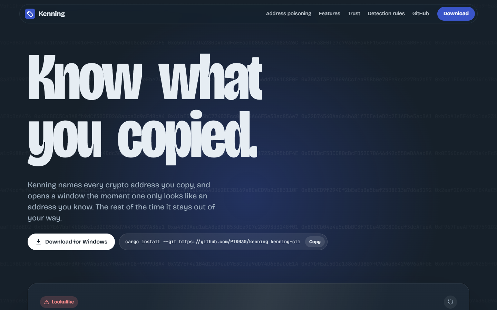
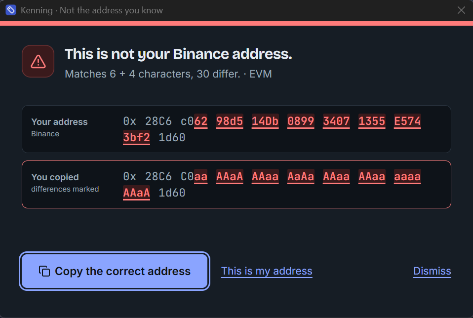

<a href="https://github.com/PTK030/kenning"></a>

Kenning
=======

[](LICENSE)
[](https://github.com/PTK030/kenning/stargazers)
[](https://www.rust-lang.org)
[](#desktop-app-recommended)
[](#network)

Know what you copied: Kenning names every crypto address you copy and tells you when one only looks like an address you know.

<a href="site/"></a>

<a href="docs/images/lookalike-window.png"></a>

Address poisoning works because people check the first and last few characters of an address. Someone generates an address with the same start and end as one you use, sends you a tiny transfer, and waits for you to copy the wrong one from your history. Kenning keeps a local book of the addresses you use. When you copy an address it already knows, a small badge confirms the name and disappears. When you copy one that only resembles an address you know, it shows both in full and gives you the correct one back.

- **Your names:** label wallets, deposit addresses and multisigs once, see the name every time you copy them.
- **Lookalikes caught:** a copied address that shares its start and end with a known one opens a window with every difference marked.
- **Details on demand:** select an address anywhere and press `Ctrl+Alt+D` to see its name, history and on-chain activity in the middle of the screen. Your clipboard is left as it was.
- **One click to fix:** "Copy the correct address" puts yours back on the clipboard; "This is my address" remembers a new one for good.
- **Quiet by design:** known addresses get a badge for a few seconds, with a soft sound you can turn off. Nothing takes focus from what you are doing.
- **Four chains:** EVM with EIP-55 checksums, Solana, Bitcoin (legacy, segwit, taproot) and Tron.
- **Public labels with sources:** routers, stablecoins and exchanges are recognised out of the box, each with a link to where the label came from.
- **Team books and a journal:** point Kenning at a read-only book in your team's repo, and keep a local record of every check for audits.
- **Local-first:** no account, no telemetry, no servers. The recognition engine has no network code at all; on-chain lookups are optional and off by default.

**[Read how lookalikes are detected](docs/detection-rules.md)**

## Getting Started

### Prerequisites

- Windows 10 or 11 (macOS and Linux are planned)
- [Rust](https://rustup.rs) 1.90 or newer
- [Node.js](https://nodejs.org) 20 or newer, for the desktop app's interface
- WebView2, which ships with Windows 11

### Desktop app (recommended)

```bash
git clone https://github.com/PTK030/kenning
cd kenning/apps/desktop
npm install
npx tauri dev
```

The tag icon appears in the system tray. The first launch walks you through six short steps: how Kenning speaks, when it reads the clipboard (only on `Ctrl+Alt+K`, or on every copy), your first addresses, a few preferences, and a live test with a known address and a lookalike.

To build the installers:

```bash
npx tauri build
```

This produces `target/release/bundle/nsis/Kenning_0.1.0_x64-setup.exe` (per-user, no admin rights needed) and `target/release/bundle/msi/Kenning_0.1.0_x64_en-US.msi`. Neither is code-signed yet, so Windows SmartScreen asks once before running them. Installer artwork comes from `apps/desktop/scripts/make-installer-art.py`.

### CLI

```bash
cargo install --git https://github.com/PTK030/kenning kenning-cli
```

## CLI

```bash
# Name an address
ken add 0x28C6c06298d514Db089934071355E5743bf21d60 Binance --note "my deposits"

# Recognise an address (exit code 0 known, 10 new, 20 lookalike)
ken 0x28c6c0aaaaaaaaaaaaaaaaaaaaaaaaaaaaaa1d60

# Every address in a log, a transaction or a chat export
cast logs --from-block latest | ken check -

# Compare two addresses character by character
ken diff 0x28C6c06298d514Db089934071355E5743bf21d60 0x28c6c0aaaaaaaaaaaaaaaaaaaaaaaaaaaaaa1d60

# Import a Safe{Wallet} address book export, or Kenning's own CSV
ken import safe-address-book.csv --owner team

# What was checked, when, by whom
ken log

# Ask the chain too (sends only the address)
ken --online 0x68b3465833fb72A70ecDF485E0e4C7bD8665Fc45
```

Every command takes `--json`. `ken serve --stdio` speaks JSON-RPC for other programs, and `ken paths` shows where Kenning keeps its files.

## Network

On-chain lookups are off until you turn them on (tray menu or Settings, or `--online` per command). When on, Kenning sends the address it is showing, and nothing else, to one public provider per chain:

| Chain | Host |
|---|---|
| EVM (Ethereum mainnet) | `eth.blockscout.com` |
| Solana | `api.mainnet-beta.solana.com`, or your own RPC |
| Bitcoin | `mempool.space` |
| Tron | `api.trongrid.io` |

It shows whether an address has ever been used, its transaction count, and whether it is a verified contract. A lookalike that was never used is a strong sign. Answers are cached for an hour. The lookups live in `crates/kenning-net`; `crates/kenning-core` stays free of network code, and `cargo deny` enforces it.

## Files

Everything lives in `~/.kenning` (or `KENNING_HOME`):

| File | Contents |
|---|---|
| `book.toml` | Your address book. Plain TOML, safe to edit and commit. |
| `config.toml` | Settings, including shared team books: `books = ["~/repo/ops/kenning.toml"]`. |
| `history.json` | Addresses you copied, how often and when. Validated addresses only, never other clipboard text. Can be turned off. |
| `journal.jsonl` | The verification journal. |
| `net-cache.json` | On-chain answers, only if the network is on. |

## Development

```bash
cargo test --workspace
cargo clippy --workspace --all-targets
cargo deny --manifest-path crates/kenning-core/Cargo.toml check
node apps/desktop/scripts/check-contrast.mjs
```

The landing page is React with Motion and Lenis, built to static files:

```bash
cd site
npm install
npm run dev      # http://localhost:5173
npm run build    # site/dist
```

```
crates/kenning-core     recognition, lookalikes, book, history, journal (no network code)
crates/kenning-net      optional on-chain lookups
crates/kenning-cli      the `ken` binary
crates/kenning-labels   built-in public labels, each with a source
apps/desktop            tray app: Tauri 2, TypeScript, no UI framework
site                    landing page: React, Motion, Lenis; builds to static files, no third-party requests
tests/lookalikes        public test corpus for the detection rules
```

Changes to the detection rules go together with [docs/detection-rules.md](docs/detection-rules.md) and new cases in [tests/lookalikes/](tests/lookalikes/). The desktop shell decision and its measurements are in [docs/desktop-gate.md](docs/desktop-gate.md).

## License

[MIT](LICENSE)
