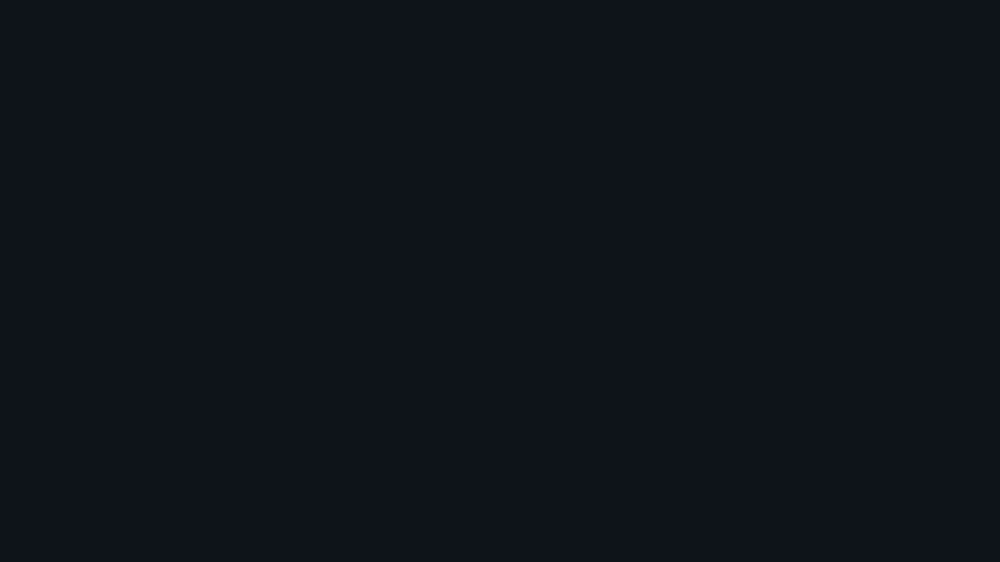
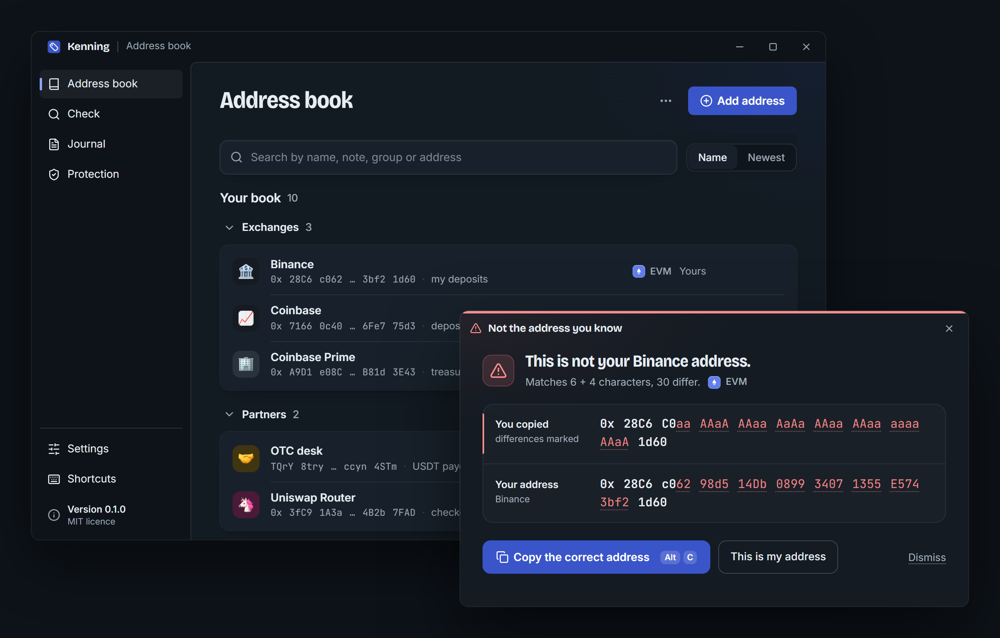

<p align="center">
  <a href="https://github.com/PTK030/kenning"></a>
</p>

<h1 align="center">Kenning</h1>

<p align="center">
  <a href="README.md">English</a> ·
  <a href="README.zh-CN.md">简体中文</a> ·
  <a href="README.ja.md">日本語</a> ·
  <a href="README.ko.md">한국어</a> ·
  <b>Polski</b>
</p>

<p align="center">
  <b>Wiedz, co kopiujesz.</b><br>
  Kenning nazywa każdy kopiowany adres krypto i ostrzega cię w chwili, gdy któryś tylko przypomina adres, który znasz.
</p>

<p align="center">
  <a href="https://github.com/PTK030/kenning/releases"><b>Pobierz</b></a> ·
  <a href="docs/detection-rules.md"><b>Reguły wykrywania</b></a> ·
  <a href="#cli-1"><b>CLI</b></a> ·
  <a href="CHANGELOG.md"><b>Lista zmian</b></a> ·
  <a href="CONTRIBUTING.md"><b>Współtworzenie</b></a> ·
  <a href="SECURITY.md"><b>Bezpieczeństwo</b></a>
</p>

<p align="center">
  <a href="https://github.com/PTK030/kenning/stargazers"></a>
  <a href="CHANGELOG.md"></a>
  <a href="LICENSE"></a>
  <a href="https://www.rust-lang.org"></a>
</p>

<p align="center">
  <a href="https://github.com/PTK030/kenning/releases"></a>
</p>

Zatruwanie adresów (address poisoning) działa, bo ludzie sprawdzają tylko kilka pierwszych i ostatnich znaków adresu. Ktoś generuje adres o takim samym początku i końcu jak ten, którego używasz, wysyła ci drobny przelew i czeka, aż skopiujesz z historii niewłaściwy. Kenning prowadzi lokalną książkę adresów, których używasz. Gdy kopiujesz adres, który już zna, mały badge potwierdza jego nazwę i znika. Gdy kopiujesz taki, który tylko przypomina znany ci adres, Kenning pokazuje oba w całości i oddaje ci właściwy.

- **Twoje nazwy:** raz podpisz portfele, adresy depozytowe i multisigi, a nazwę zobaczysz przy każdym kopiowaniu.
- **Wyłapane sobowtóry:** skopiowany adres o tym samym początku i końcu co znany otwiera okno z zaznaczoną każdą różnicą.
- **Szczegóły na żądanie:** zaznacz adres w dowolnym miejscu i naciśnij `Ctrl+Alt+D`, a na środku ekranu zobaczysz jego nazwę, historię i aktywność on-chain. Schowek zostaje nietknięty.
- **Poprawka jednym kliknięciem:** "Copy the correct address" wkłada twój adres z powrotem do schowka; "This is my address" na stałe zapamiętuje nowy.
- **Cichy z założenia:** znane adresy dostają badge na kilka sekund, z cichym dźwiękiem, który możesz wyłączyć. Nic nie odciąga cię od tego, czym się zajmujesz.
- **Cztery łańcuchy:** EVM z sumami kontrolnymi EIP-55, Solana, Bitcoin (legacy, segwit, taproot) i Tron.
- **Publiczne etykiety ze źródłami:** routery, stablecoiny i giełdy są rozpoznawane od razu, a każda etykieta ma link do swojego źródła.
- **Książki zespołowe i dziennik:** wskaż Kenningowi książkę tylko do odczytu w repozytorium zespołu i prowadź lokalny zapis każdego sprawdzenia na potrzeby audytów.
- **Przede wszystkim lokalnie:** bez konta, bez telemetrii, bez serwerów. Silnik rozpoznawania nie ma żadnego kodu sieciowego; zapytania on-chain są opcjonalne i domyślnie wyłączone.

<p align="center">
  
</p>

**[Zobacz, jak wykrywane są sobowtóry](docs/detection-rules.md)**: reguły są publiczne, podobnie jak przypadki testowe w [tests/lookalikes/](tests/lookalikes/).

## Dlaczego buduję Kenninga

Każda historia o zatruwaniu adresów, jaką czytałem, wyglądała tak samo. Ktoś co tydzień wpłaca na ten sam adres depozytowy na giełdzie. Pewnego ranka w jego historii pojawia się przelew o zerowej wartości z adresu, który zaczyna się od `0x28C6` i kończy na `1d60`, zupełnie jak jego. Kopiuje najnowszy wiersz, jak zawsze sprawdza pierwsze i ostatnie znaki, i wkleja.

Nikt w tej historii nie jest nieostrożny. Portfele skracają adresy do początku i końca, więc ludzie uczą się sprawdzać właśnie to. A początek i koniec to dokładnie to, co atakujący wygeneruje w kilka minut na karcie graficznej. Badacze naliczyli w ciągu dwóch lat 270 milionów prób na Ethereum i BSC oraz co najmniej 83,8 mln dolarów strat ([USENIX Security 2025](https://www.usenix.org/conference/usenixsecurity25/presentation/tsuchiya)).

Nie chciałem pisać kolejnego ostrzeżenia, które ludzie mają przeczytać. Chciałem, żeby komputer zrobił jedyne sprawdzenie, którego ludzie zrobić nie są w stanie: porównał każdy znak z adresami, których naprawdę używasz, w chwili kopiowania, a przez resztę czasu siedział cicho. Tym właśnie jest Kenning. Działa na twoim komputerze, nie wymaga konta, a jego reguły są publiczne, więc możesz je sprawdzić samodzielnie.

## Jak to działa

| | Co robisz | Co robi Kenning |
|---|---|---|
| **1** | Kopiujesz adres z portfela, eksploratora, czatu albo arkusza (i naciskasz `Ctrl+Alt+K`, chyba że Kenning czyta każde kopiowanie). | Sprawdza jego poprawność dla danego łańcucha i szuka go w twojej książce, w książkach zespołu i w publicznych etykietach. |
| **2** | Nic, jeśli to adres, który znasz. | Na kilka sekund pokazuje badge z jego nazwą, nie przejmując fokusu. |
| **3** | Nic, jeśli tylko przypomina adres, który znasz. | Otwiera okno z oboma adresami w całości i zaznaczonym każdym różniącym się znakiem. Jedno kliknięcie przywraca właściwy adres. |

Wszystko powyżej dzieje się na twoim komputerze. Nic nie jest nigdzie wysyłane, chyba że włączysz [zapytania on-chain](#sieć).

## Pierwsze kroki

### Wymagania

- Windows 10 lub 11 (macOS i Linux są w planach)
- [Rust](https://rustup.rs) 1.90 lub nowszy
- [Node.js](https://nodejs.org) 20 lub nowszy, do interfejsu aplikacji desktopowej
- WebView2, który jest częścią Windows 11

### Aplikacja desktopowa (zalecana)

```bash
git clone https://github.com/PTK030/kenning
cd kenning/apps/desktop
npm install
npx tauri dev
```

W zasobniku systemowym pojawia się ikona etykiety. Przy pierwszym uruchomieniu przejdziesz przez sześć krótkich kroków: jak Kenning daje znać, kiedy czyta schowek (tylko po `Ctrl+Alt+K` albo przy każdym kopiowaniu), twoje pierwsze adresy, kilka ustawień i test na żywo ze znanym adresem i sobowtórem.

Aby zbudować instalatory:

```bash
npx tauri build
```

Powstają `target/release/bundle/nsis/Kenning_0.1.0_x64-setup.exe` (instalacja dla bieżącego użytkownika, bez uprawnień administratora) oraz `target/release/bundle/msi/Kenning_0.1.0_x64_en-US.msi`. Żaden z nich nie jest jeszcze podpisany cyfrowo, więc Windows SmartScreen raz zapyta o zgodę przed uruchomieniem. Grafiki instalatora generuje `apps/desktop/scripts/make-installer-art.py`. Jak opublikować wydanie, do którego zainstalowane kopie mogą się zaktualizować: [docs/releasing.md](docs/releasing.md).

### CLI

```bash
cargo install --git https://github.com/PTK030/kenning kenning-cli
```

## CLI

Wszystko, co badge i okno mówią tobie, polecenie `ken` mówi twoim skryptom.

```bash
# Name an address
ken add 0x28C6c06298d514Db089934071355E5743bf21d60 Binance --note "my deposits"

# Recognise an address (exit code 0 known, 10 new, 20 lookalike)
ken 0x28c6c0aaaaaaaaaaaaaaaaaaaaaaaaaaaaaa1d60

# Every address in a log, a transaction or a chat export
cast logs --from-block latest | ken check -

# Compare two addresses character by character
ken diff 0x28C6c06298d514Db089934071355E5743bf21d60 0x28c6c0aaaaaaaaaaaaaaaaaaaaaaaaaaaaaa1d60

# Import a Safe{Wallet} address book export, or Kenning's own CSV
ken import safe-address-book.csv --owner team

# What was checked, when, by whom
ken log

# Ask the chain too (sends only the address)
ken --online 0x68b3465833fb72A70ecDF485E0e4C7bD8665Fc45
```

Tak wygląda sobowtór w terminalu:

```text
$ ken 0x28C6C0aaAAaAAAaaAaAaAAaaAAaaaaaaAAaA1d60
! This is not your Binance address.  lookalike
  Matches 6 + 4 characters, 30 differ.

  copied  0x 28C6 C0aa AAaA AAaa AaAa AAaa AAaa aaaa AAaA 1d60
  yours   0x 28C6 c062 98d5 14Db 0899 3407 1355 E574 3bf2 1d60  Binance

  The address you know is the second line: 0x28C6c06298d514Db089934071355E5743bf21d60
```

Każde polecenie przyjmuje `--json`. `ken serve --stdio` obsługuje JSON-RPC dla innych programów, a `ken paths` pokazuje, gdzie Kenning trzyma swoje pliki.

## Sieć

Zapytania on-chain są wyłączone, dopóki ich nie włączysz (w menu zasobnika, w Settings albo flagą `--online` dla pojedynczego polecenia). Gdy są włączone, Kenning wysyła wyświetlany adres, i nic poza nim, do jednego publicznego dostawcy dla każdego łańcucha:

| Łańcuch | Host |
|---|---|
| EVM (Ethereum mainnet) | `eth.blockscout.com` |
| Solana | `api.mainnet-beta.solana.com` albo twój własny RPC |
| Bitcoin | `mempool.space` |
| Tron | `api.trongrid.io` |

Kenning pokazuje, czy adres był kiedykolwiek używany, ile ma transakcji i czy jest zweryfikowanym kontraktem. Sobowtór, którego nikt nigdy nie używał, to mocny sygnał ostrzegawczy. Odpowiedzi trafiają do pamięci podręcznej na godzinę. Kod zapytań znajduje się w `crates/kenning-net`; `crates/kenning-core` pozostaje wolny od kodu sieciowego, a pilnuje tego `cargo deny`.

Sprawdzanie aktualizacji (przy starcie i co 12 godzin, wyłącznie do github.com) jest proponowane podczas konfiguracji i można je wyłączyć w Settings.

## Pliki

Wszystko trafia do `~/.kenning` (albo `KENNING_HOME`):

| Plik | Zawartość |
|---|---|
| `book.toml` | Twoja książka adresowa. Zwykły TOML, który możesz bezpiecznie edytować i commitować. |
| `config.toml` | Ustawienia, w tym współdzielone książki zespołu: `books = ["~/repo/ops/kenning.toml"]`. |
| `history.json` | Skopiowane adresy: jak często i kiedy. Tylko poprawne adresy, nigdy inny tekst ze schowka. Można wyłączyć. |
| `journal.jsonl` | Dziennik weryfikacji. |
| `net-cache.json` | Odpowiedzi z zapytań on-chain, tylko gdy dostęp do sieci jest włączony. |

## Plan rozwoju

| Gotowe | Teraz | Dalej |
|---|---|---|
| EVM, Solana, Bitcoin i Tron, z sumami kontrolnymi | Pierwsze wydanie z instalatorami na GitHubie | Linux i macOS |
| Wykrywanie sobowtórów z publicznymi regułami i 17 przypadkami testowymi | | Podpisane instalatory |
| Badge, okno sobowtóra i okno szczegółów | | Silnik jako biblioteka, którą mogą osadzać portfele open source |
| Wiersz poleceń z wyjściem JSON i JSON-RPC | | Reguły wykrywania jako wersjonowana specyfikacja |
| Książki zespołowe, lokalny dziennik, import z Safe{Wallet} | | |
| Zapytania on-chain, domyślnie wyłączone | | |

Co zmieniło się w poszczególnych wersjach, znajdziesz na [liście zmian](CHANGELOG.md).

## Praca nad kodem

```bash
npm install          # at the root: the git hooks
npm run dev          # the desktop app, reloading as you edit
npm run check        # what CI runs: clippy, tests, builds, contrast
npm run deny         # the licence check, and no network code in kenning-core
```

```
crates/kenning-core     recognition, lookalikes, book, history, journal (no network code)
crates/kenning-net      optional on-chain lookups
crates/kenning-cli      the `ken` binary
crates/kenning-labels   built-in public labels, each with a source
apps/desktop            tray app: Tauri 2, TypeScript, no UI framework
tests/lookalikes        public test corpus for the detection rules
```

Zmiany w regułach wykrywania idą w parze ze zmianami w [docs/detection-rules.md](docs/detection-rules.md) i nowymi przypadkami w [tests/lookalikes/](tests/lookalikes/). Decyzję w sprawie powłoki aplikacji desktopowej i jej pomiary opisuje [docs/desktop-gate.md](docs/desktop-gate.md). [docs/development.md](docs/development.md) omawia strukturę projektu, katalog danych deweloperskich i typowe pułapki.

## Współtworzenie

Issues i pull requesty są mile widziane. Przy czymkolwiek większym niż drobna poprawka najpierw otwórz issue, żeby uzgodnić podejście, zanim poświęcisz na to czas. W [CONTRIBUTING.md](CONTRIBUTING.md) znajdziesz konfigurację środowiska, testy do uruchomienia przed pull requestem, format commitów i zasady, dzięki którym Kenning pozostaje godny zaufania:

- `kenning-core` nigdy nie łączy się z siecią.
- Nic, co zostało odczytane ze schowka, nie jest zapisywane, z wyjątkiem poprawnych adresów.
- Ostrzeżenie nigdy nie działa samo z siebie i nigdy nie uznaje przypadkowo wciśniętego klawisza za zgodę.

Każdy, kto bierze udział w projekcie, powinien przestrzegać [Kodeksu postępowania](CODE_OF_CONDUCT.md).

## Bezpieczeństwo

Kenning stoi między tobą a płatnością, więc luka w nim może kogoś kosztować utratę środków. Nie zgłaszaj jej w publicznym issue: użyj zamiast tego [Report a vulnerability](https://github.com/PTK030/kenning/security/advisories/new). Sobowtór, który się prześlizgnie, też się liczy. [SECURITY.md](SECURITY.md) opisuje, co obejmuje zakres zgłoszeń i jak Kenning jest zbudowany, żeby był bezpieczny.

## Wesprzyj Kenninga

Kenning jest darmowy, ma otwarty kod i tworzy go jedna osoba. Najbardziej pomożesz, jeśli:

- **Dasz repozytorium gwiazdkę**, żeby więcej osób trafiło na nie, zanim wklei zły adres.
- **[Zgłosisz sobowtóra, którego Kenning nie wyłapał](https://github.com/PTK030/kenning/security/advisories/new)**, poufnie, żeby można było to naprawić i dodać nowy przypadek do [tests/lookalikes/](tests/lookalikes/).
- **Pokażesz go osobie w zespole, która robi wypłaty na adresy kopiowane z historii.**

## Licencja

[MIT](LICENSE)

Grafiki emoji w książce adresowej to zestaw 3D [Noto Emoji](https://github.com/googlefonts/noto-emoji) od Google, udostępniany na własnej licencji: zobacz [apps/desktop/ui/src/assets/emoji/](apps/desktop/ui/src/assets/emoji/).
