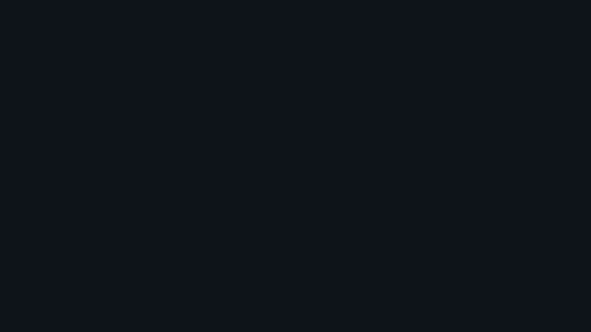
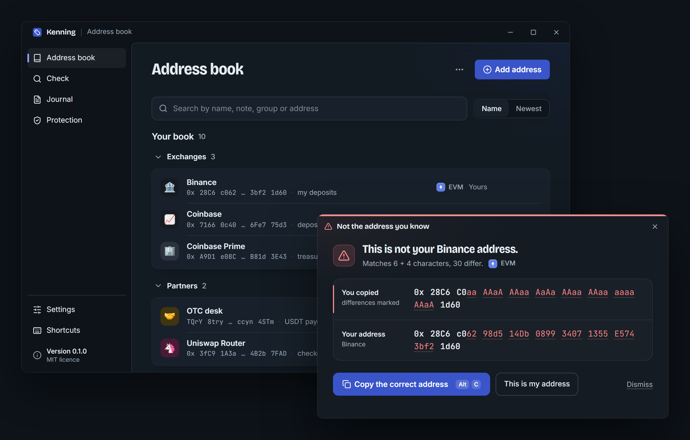

<p align="center">
  <a href="https://github.com/PTK030/kenning"></a>
</p>

<h1 align="center">Kenning</h1>

<p align="center">
  <a href="README.md">English</a> ·
  <b>简体中文</b> ·
  <a href="README.ja.md">日本語</a> ·
  <a href="README.ko.md">한국어</a> ·
  <a href="README.pl.md">Polski</a>
</p>

<p align="center">
  <b>复制了什么，心里有数。</b><br>
  Kenning 会为你复制的每个加密地址显示名称；一旦某个地址只是长得像你认识的地址，它会立刻提醒你。
</p>

<p align="center">
  <a href="https://github.com/PTK030/kenning/releases"><b>下载</b></a> ·
  <a href="docs/detection-rules.md"><b>检测规则</b></a> ·
  <a href="#cli-1"><b>CLI</b></a> ·
  <a href="CHANGELOG.md"><b>更新日志</b></a> ·
  <a href="CONTRIBUTING.md"><b>参与贡献</b></a> ·
  <a href="SECURITY.md"><b>安全</b></a>
</p>

<p align="center">
  <a href="https://github.com/PTK030/kenning/stargazers"></a>
  <a href="CHANGELOG.md"></a>
  <a href="LICENSE"></a>
  <a href="https://www.rust-lang.org"></a>
</p>

<p align="center">
  <a href="https://github.com/PTK030/kenning/releases"></a>
</p>

地址投毒之所以得手，是因为人们只核对地址开头和结尾的几个字符。攻击者生成一个首尾与你常用地址相同的地址，给你转一笔极小的金额，然后等你从交易记录里复制错。Kenning 在本地维护一本地址簿，记下你常用的地址。复制到已知地址时，会弹出一个小徽标确认名称，随后自动消失。复制到一个只是看起来像已知地址的地址时，它会把两个地址完整显示出来，并把正确的那个还给你。

- **你的命名**：钱包、充值地址和多签只需标记一次，以后每次复制都能看到名称。
- **拦截仿冒地址**：复制的地址如果首尾与某个已知地址相同，会弹出窗口，标出每一处差异。
- **按需查看详情**：在任意位置选中一个地址，按 `Ctrl+Alt+D`，屏幕中央就会显示它的名称、历史记录和链上活动。剪贴板内容保持不变。
- **一键纠正**：“Copy the correct address” 会把你的地址放回剪贴板；“This is my address” 会永久记住一个新地址。
- **安静不打扰**：已知地址只显示几秒钟的徽标，并伴有一声轻柔的提示音（可关闭）。不会抢走你当前操作的焦点。
- **支持四条链**：EVM（含 EIP-55 校验和）、Solana、Bitcoin（legacy、segwit、taproot）和 Tron。
- **公开标签，注明来源**：开箱即可识别路由合约、稳定币和交易所，每个标签都附有来源链接。
- **团队地址簿与日志**：让 Kenning 读取团队仓库中的一份只读地址簿，并在本地记录每一次核验，便于审计。
- **本地优先**：无需账号，没有遥测，没有服务器。识别引擎完全不含网络代码；链上查询是可选功能，默认关闭。

<p align="center">
  
</p>

**[了解仿冒地址的检测方式](docs/detection-rules.md)**：规则是公开的，[tests/lookalikes/](tests/lookalikes/) 中的测试用例也是。

## 我为什么要做 Kenning

我读过的每一个地址投毒案例，经过都差不多。有人每周都往同一个交易所充值地址转账。某天早上，他的交易记录里多了一笔零金额转账，来自一个以 `0x28C6` 开头、以 `1d60` 结尾的地址，和他的地址一模一样。他照常复制最新的那一行，照常核对首尾几个字符，然后粘贴。

这个故事里没有谁粗心大意。钱包只显示地址的首尾，人们自然也就学会了只核对首尾。而首尾恰恰是攻击者用显卡跑几分钟就能生成的部分。研究人员统计，两年内 Ethereum 和 BSC 上出现了 2.7 亿次投毒尝试，损失至少 8380 万美元（[USENIX Security 2025](https://www.usenix.org/conference/usenixsecurity25/presentation/tsuchiya)）。

我不想再写一篇警示文章让人去读。我想让电脑来做那项人做不到的检查：在你复制的那一刻，把每个字符和你真正在用的地址逐一比对，其余时间保持安静。这就是 Kenning。它运行在你自己的电脑上，无需账号，规则公开，你可以自己核查。

## 工作原理

| | 你的操作 | Kenning 的处理 |
|---|---|---|
| **1** | 从钱包、区块浏览器、聊天记录或表格中复制一个地址（如果 Kenning 没有设为读取每次复制，再按一下 `Ctrl+Alt+K`）。 | 按所属链校验地址，并在你的地址簿、团队地址簿和公开标签中查找。 |
| **2** | 如果是已知地址：无需操作。 | 显示一个带名称的徽标，持续几秒，不抢占焦点。 |
| **3** | 如果只是长得像已知地址：同样无需操作。 | 弹出窗口，完整显示两个地址，并标出每一个不同的字符。点一下即可放回正确的地址。 |

以上所有操作都在你的电脑上完成。除非你开启[链上查询](#网络)，否则不会向任何地方发送数据。

## 快速上手

### 环境要求

- Windows 10 或 11（macOS 和 Linux 已在计划中）
- [Rust](https://rustup.rs) 1.90 或更高版本
- [Node.js](https://nodejs.org) 20 或更高版本，用于桌面应用的界面
- WebView2，Windows 11 已自带

### 桌面应用（推荐）

```bash
git clone https://github.com/PTK030/kenning
cd kenning/apps/desktop
npm install
npx tauri dev
```

系统托盘中会出现一个标签图标。首次启动会引导你完成六个简短步骤：Kenning 的提示方式、何时读取剪贴板（仅在按下 `Ctrl+Alt+K` 时，或每次复制时）、添加你的第一批地址、几项偏好设置，以及用一个已知地址和一个仿冒地址做一次实际测试。

构建安装包：

```bash
npx tauri build
```

这会生成 `target/release/bundle/nsis/Kenning_0.1.0_x64-setup.exe`（按用户安装，无需管理员权限）和 `target/release/bundle/msi/Kenning_0.1.0_x64_en-US.msi`。两者目前都还没有代码签名，所以首次运行前 Windows SmartScreen 会询问一次。安装程序的图片素材由 `apps/desktop/scripts/make-installer-art.py` 生成。如何发布一个已安装的副本能够自动更新到的版本，见 [docs/releasing.md](docs/releasing.md)。

### CLI

```bash
cargo install --git https://github.com/PTK030/kenning kenning-cli
```

## CLI

徽标和窗口能告诉你的一切，`ken` 命令都能告诉你的脚本。

```bash
# Name an address
ken add 0x28C6c06298d514Db089934071355E5743bf21d60 Binance --note "my deposits"

# Recognise an address (exit code 0 known, 10 new, 20 lookalike)
ken 0x28c6c0aaaaaaaaaaaaaaaaaaaaaaaaaaaaaa1d60

# Every address in a log, a transaction or a chat export
cast logs --from-block latest | ken check -

# Compare two addresses character by character
ken diff 0x28C6c06298d514Db089934071355E5743bf21d60 0x28c6c0aaaaaaaaaaaaaaaaaaaaaaaaaaaaaa1d60

# Import a Safe{Wallet} address book export, or Kenning's own CSV
ken import safe-address-book.csv --owner team

# What was checked, when, by whom
ken log

# Ask the chain too (sends only the address)
ken --online 0x68b3465833fb72A70ecDF485E0e4C7bD8665Fc45
```

仿冒地址在终端中是这样显示的：

```text
$ ken 0x28C6C0aaAAaAAAaaAaAaAAaaAAaaaaaaAAaA1d60
! This is not your Binance address.  lookalike
  Matches 6 + 4 characters, 30 differ.

  copied  0x 28C6 C0aa AAaA AAaa AaAa AAaa AAaa aaaa AAaA 1d60
  yours   0x 28C6 c062 98d5 14Db 0899 3407 1355 E574 3bf2 1d60  Binance

  The address you know is the second line: 0x28C6c06298d514Db089934071355E5743bf21d60
```

所有命令都支持 `--json`。`ken serve --stdio` 通过 JSON-RPC 与其他程序通信，`ken paths` 显示 Kenning 的文件存放位置。

## 网络

链上查询在你开启之前一直是关闭的（可以在托盘菜单或 Settings 中开启，也可以在单条命令中加 `--online`）。开启后，Kenning 只会把当前显示的那个地址发送给每条链对应的一个公共服务商，不发送任何其他内容：

| 链 | 主机 |
|---|---|
| EVM (Ethereum mainnet) | `eth.blockscout.com` |
| Solana | `api.mainnet-beta.solana.com`，或你自己的 RPC |
| Bitcoin | `mempool.space` |
| Tron | `api.trongrid.io` |

它会显示该地址是否被使用过、交易笔数，以及是否为已验证合约。一个从未被使用过的仿冒地址是很强的危险信号。查询结果缓存一小时。查询代码位于 `crates/kenning-net`；`crates/kenning-core` 不含任何网络代码，并由 `cargo deny` 强制保证。

更新检查（启动时检查一次，之后每 12 小时一次，只连接 github.com）会在初始设置时询问是否开启，之后可以在 Settings 中关闭。

## 文件

所有文件都存放在 `~/.kenning`（或 `KENNING_HOME`）中：

| 文件 | 内容 |
|---|---|
| `book.toml` | 你的地址簿。纯 TOML 格式，可以放心编辑并提交到仓库。 |
| `config.toml` | 设置，包括共享的团队地址簿：`books = ["~/repo/ops/kenning.toml"]`。 |
| `history.json` | 你复制过的地址、复制次数和时间。只记录校验通过的地址，绝不记录剪贴板中的其他文本。可以关闭。 |
| `journal.jsonl` | 核验日志。 |
| `net-cache.json` | 链上查询结果，仅在开启网络功能时存在。 |

## 路线图

| 已完成 | 进行中 | 下一步 |
|---|---|---|
| EVM、Solana、Bitcoin 和 Tron，支持校验和 | 首个版本，在 GitHub 上提供安装包 | Linux 和 macOS |
| 仿冒地址检测，规则公开，附 17 个测试用例 | | 签名的安装包 |
| 徽标、仿冒地址窗口和详情窗口 | | 将引擎做成库，供开源钱包集成 |
| 命令行，支持 JSON 输出和 JSON-RPC | | 将检测规则整理为带版本号的规范 |
| 团队地址簿、本地日志、Safe{Wallet} 导入 | | |
| 链上查询，默认关闭 | | |

各版本的变更见[更新日志](CHANGELOG.md)。

## 开发

```bash
npm install          # at the root: the git hooks
npm run dev          # the desktop app, reloading as you edit
npm run check        # what CI runs: clippy, tests, builds, contrast
npm run deny         # the licence check, and no network code in kenning-core
```

```
crates/kenning-core     recognition, lookalikes, book, history, journal (no network code)
crates/kenning-net      optional on-chain lookups
crates/kenning-cli      the `ken` binary
crates/kenning-labels   built-in public labels, each with a source
apps/desktop            tray app: Tauri 2, TypeScript, no UI framework
tests/lookalikes        public test corpus for the detection rules
```

修改检测规则时，要同步更新 [docs/detection-rules.md](docs/detection-rules.md)，并在 [tests/lookalikes/](tests/lookalikes/) 中添加新用例。桌面外壳的选型决策及测量数据见 [docs/desktop-gate.md](docs/desktop-gate.md)。[docs/development.md](docs/development.md) 介绍了项目结构、开发用的数据目录以及常见的坑。

## 参与贡献

欢迎提交 issue 和 pull request。除了小修小补，其他改动请先开一个 issue，就实现思路达成一致后再投入时间。[CONTRIBUTING.md](CONTRIBUTING.md) 包含环境搭建、提交 pull request 前要运行的检查、commit 格式，以及保证 Kenning 值得信赖的几条规则：

- `kenning-core` 永远不访问网络。
- 从剪贴板读取的内容一律不保存，有效地址除外。
- 警告永远不会自行采取行动，也绝不会把误按的按键当作确认。

所有参与者都应遵守[行为准则](CODE_OF_CONDUCT.md)。

## 安全

Kenning 站在你和一笔付款之间，它的一个漏洞就可能让别人损失资金。发现漏洞请不要公开提 issue，请改用 [Report a vulnerability](https://github.com/PTK030/kenning/security/advisories/new) 提交。漏检的仿冒地址也算漏洞。[SECURITY.md](SECURITY.md) 列出了漏洞的范围，以及 Kenning 在安全方面的设计。

## 支持 Kenning

Kenning 免费、开源，由一个人独立开发。你能做的最有用的事：

- **给仓库点个 Star**，让更多人在粘贴错地址之前发现它。
- **[报告 Kenning 漏掉的仿冒地址](https://github.com/PTK030/kenning/security/advisories/new)**，请私下提交，这样它才能被修复，并成为 [tests/lookalikes/](tests/lookalikes/) 中的一个用例。
- **把它推荐给团队里那位从历史记录复制地址来付款的同事。**

## 许可证

[MIT](LICENSE)

地址簿中的 emoji 图案来自 Google 的 [Noto Emoji](https://github.com/googlefonts/noto-emoji) 3D 套件，遵循其自身的许可证：见 [apps/desktop/ui/src/assets/emoji/](apps/desktop/ui/src/assets/emoji/)。
